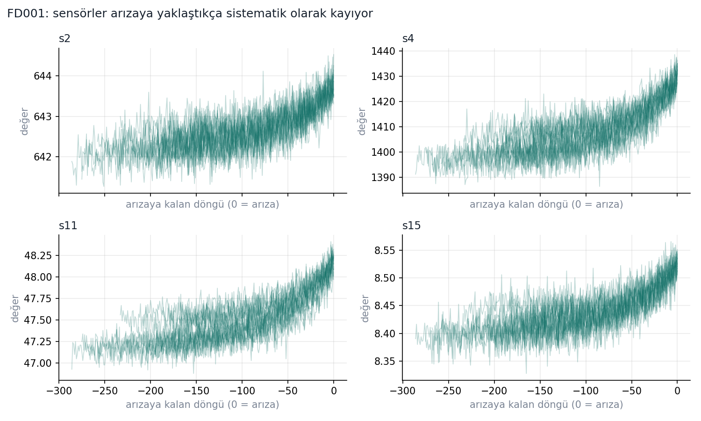
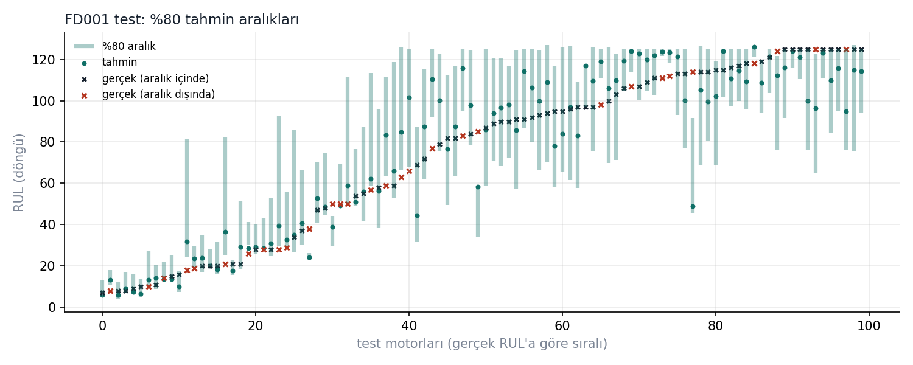

# Turbofan Engine Remaining Useful Life (RUL) Prediction

Predicting how many flight cycles an aircraft engine has left before failure, using NASA's C-MAPSS run-to-failure dataset. The focus is on **evaluation done right**: engine-level splits with no leakage, operating-condition normalization for the multi-condition subsets, prediction intervals instead of single numbers, and a maintenance decision simulation that turns predictions into cost.



## Results

Test set: the last observed cycle of every test engine, compared with NASA's ground-truth RUL (capped at 125, see below). Cross-validation: 5-fold `GroupKFold` by engine on the training set.

| Subset | Conditions | Model | CV RMSE | Test RMSE | NASA score |
|---|---|---|---|---|---|
| FD001 | 1 | Ridge (linear baseline) | 19.2 | 20.2 | 969 |
| FD001 | 1 | Random forest | 13.9 | 14.7 | 355 |
| FD001 | 1 | Gradient boosting | 13.6 | **14.4** | 415 |
| FD003 | 1 | Gradient boosting | 11.9 | **13.6** | 345 |
| FD002 | 6 | Gradient boosting, global normalization | 17.2 | 16.5 | 1332 |
| FD002 | 6 | Gradient boosting, **per-condition normalization** | 15.2 | **14.6** | 972 |
| FD004 | 6 | Gradient boosting, global normalization | 16.7 | 17.5 | 1643 |
| FD004 | 6 | Gradient boosting, **per-condition normalization** | 14.6 | **15.2** | 1006 |

Full tables, uncapped metrics and per-fold scores: [`reports/RESULTS.md`](reports/RESULTS.md) and [`reports/results.json`](reports/results.json).

**What the experiments show**

1. **Leakage inflates scores by 1.5×.** Splitting rows randomly (neighbouring cycles of the same engine in both train and validation) gives a validation RMSE of 9.1. Splitting by engine gives 13.6 on the same model. Many public notebooks on this dataset use the leaky version.
2. **Per-condition normalization matters on multi-condition data.** Six flight conditions shift sensor levels far more than degradation does. Normalizing each sensor within its operating condition (k-means on the three settings, fitted on training data only) lowers test RMSE by about 2 cycles on FD002 and FD004.
3. **Intervals are informative but under-cover.** Quantile gradient boosting (10th and 90th percentiles) should contain the truth 80% of the time; on the test sets it does so 67–80% of the time. Calibrating intervals (e.g. conformal prediction) is the next step.
4. **The reported metric changes the story.** On FD002, RMSE against capped truth is 14.6; against uncapped truth it is 26.7, because some test engines have more than 125 cycles left and the model is trained never to predict above 125. Both are reported.



## Method

```
raw cycles ──► per-condition z-score ──► drop constant sensors ──► past-only windows ──► model
               (k-means on 3 settings)    (std within condition)    (mean, std, slope)
```

- **Target:** piecewise-linear RUL capped at 125 cycles. Early in life the sensors carry no degradation signal, so asking the model to distinguish "300 cycles left" from "250 cycles left" is asking for noise.
- **Features:** for each informative sensor, the normalized value plus rolling mean and standard deviation over the last 10 cycles and the least-squares slope over the last 20 cycles. Every window uses only the current and past cycles, which is enforced by a unit test.
- **No leakage by construction:** condition clusters, normalization statistics and sensor selection are learned in `FeatureBuilder.fit()` from training engines only, and re-learned inside every cross-validation fold.
- **Models:** ridge regression, random forest and histogram gradient boosting (scikit-learn), with deliberately simple hyperparameters that were not tuned on the test set.
- **Metrics:** RMSE, MAE, the asymmetric PHM08 score (late predictions are penalized more than early ones), interval coverage and width.

## Repository layout

```
src/rul/
  config.py        constants (column names, RUL cap, window sizes)
  data.py          loading C-MAPSS files, RUL labels
  features.py      FeatureBuilder: condition normalization, sensor selection, window features
  models.py        model definitions (point and quantile)
  evaluation.py    engine-level CV, test evaluation, leakage experiment
  metrics.py       RMSE, MAE, NASA score, interval metrics
  maintenance.py   maintenance decision simulation (first version, to be rewritten by the author)
  plots.py         report figures
  cli.py           command line entry point
tests/             unit tests (data, features, metrics, evaluation, maintenance)
reports/           results.json, RESULTS.md, test predictions, figures
data/raw/          C-MAPSS text files (see data/README.md)
```

## Running

```bash
python -m venv .venv
# Windows: .venv\Scripts\activate    macOS/Linux: source .venv/bin/activate
pip install -e ".[dev]"

pytest                                   # unit tests
rul evaluate --subset FD002 --model gradient_boosting
rul run-all                              # all experiments + figures (~12 min on 2 cores)
python scripts/make_report.py            # rebuild reports/RESULTS.md
```

## Data

NASA Ames Prognostics Center of Excellence, *Turbofan Engine Degradation Simulation Data Set* (C-MAPSS). A. Saxena, K. Goebel, D. Simon, N. Eklund, "Damage Propagation Modeling for Aircraft Engine Run-to-Failure Simulation", PHM08, 2008. Details in [`data/README.md`](data/README.md).

## Limitations and next steps

- Interval calibration (conformalized quantile regression) to reach the nominal 80% coverage.
- Sequence models (1D-CNN, LSTM) on raw windows as a comparison to hand-crafted features.
- Results on published benchmarks are not directly comparable: papers differ in RUL cap, window length, test-truth capping and normalization.

---

## Türkçe özet

NASA C-MAPSS verisiyle uçak motorlarının arızaya kadar kalan ömrünü tahmin eden bir proje. Odak noktası doğru değerlendirme: motor bazlı bölme ile sızıntısız doğrulama, çok koşullu verilerde koşula göre normalizasyon, tek sayı yerine tahmin aralığı ve tahminleri maliyete çeviren bir bakım kararı simülasyonu. Kod içi açıklamalar Türkçedir.

Geliştirme: Mustafa Selim Gündüz. Proje, yapay zeka asistanı (Claude) ile birlikte geliştirildi; `maintenance.py` modülünün ilk sürümü zaman kısıtı nedeniyle yapay zeka asistanı tarafından yazıldı; kendi yazacağım sürümle değiştirilecek (testler hazır).
